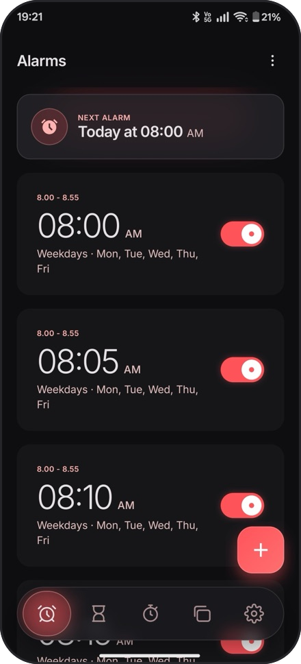
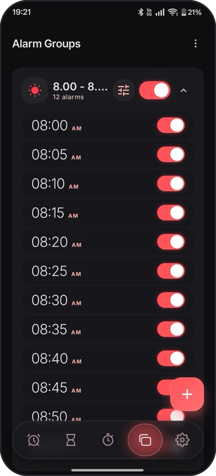
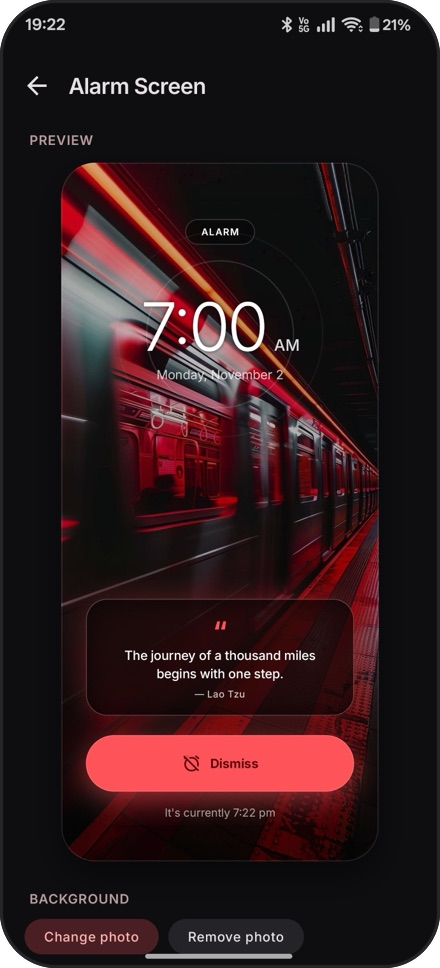
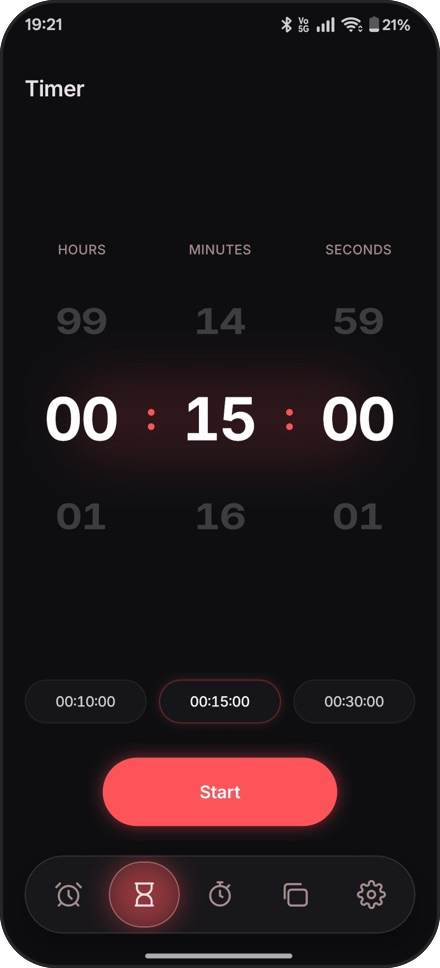
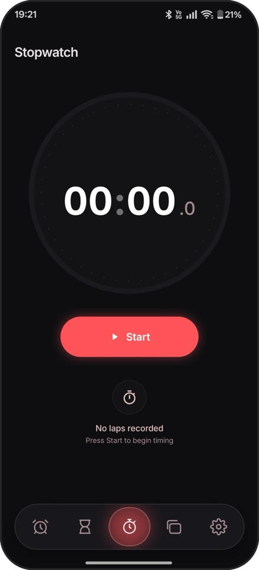
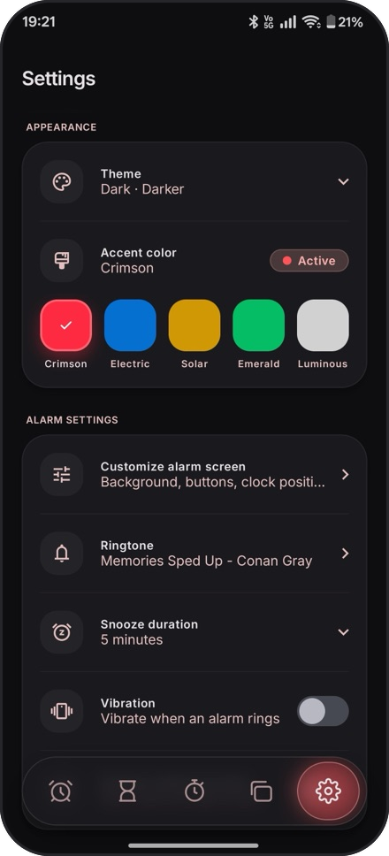
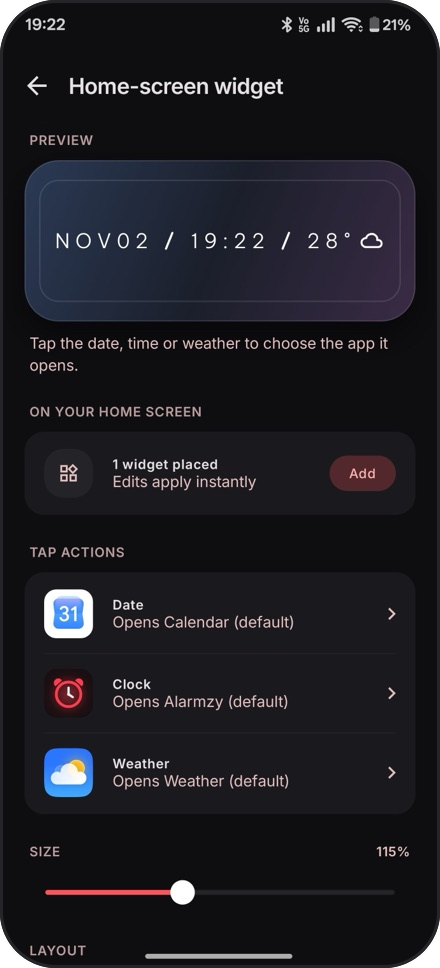
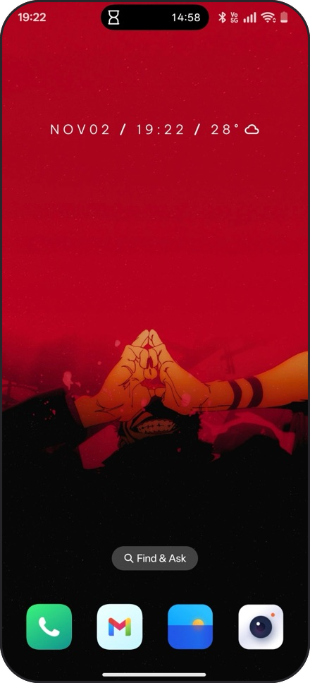

# Alarmzy

A standalone Android alarm app with **alarm grouping** as its killer feature. Create named groups of alarms and toggle them all on or off with a single switch.

## Why Alarmzy?

Google Clock doesn't support alarm grouping. Samsung's Clock app does, but it's locked to Samsung devices. Alarmzy brings this feature to every Android phone.

## Features

### Core Alarm
- Create, edit, and delete alarms with a dial time picker
- Repeat modes: Once, Daily, Weekdays, Weekends, or custom day selection
- Alarm labels
- Ringtone selection from device alarm tones with preview
- Vibration toggle
- Configurable snooze duration (5/10/15/20/30 min)
- Gradual volume increase
- Fullscreen alarm screen over lock screen with Snooze and Dismiss
- Next alarm indicator on the home screen

### Alarm Grouping
- Create named groups (e.g., Work, Gym, Weekend)
- Assign alarms to groups from either the alarm or group editor
- **Master toggle** on each group — one tap to enable or disable all alarms in the group
- Expandable group cards showing member alarms
- Group badge on alarm cards for quick identification
- An alarm can belong to one group at a time; deleting a group keeps its alarms

### Clock
- Timer with preset chips and a live countdown notification
- Stopwatch with laps
- Both survive tab switches, process death and reboot
- Android 16 Live Updates for running timers and the stopwatch

### Widget
- Home-screen clock widget: `NOV 02 / 19:22 / 28°`
- Horizontal one-line or stacked layout, adjustable size
- Date, time and weather each open an app of your choice
- Optional weather (off by default) via Open-Meteo, or OpenWeather with your own key

### Settings
- Always-dark theme with five accent colors and two dark variants
- Default snooze duration, vibration, and gradual volume preferences
- Customizable alarm screen: background photo, quote and clock position

## Screenshots

<p align="center">
  
  &nbsp;
  
  &nbsp;
  
</p>
<p align="center">
  
  &nbsp;
  
  &nbsp;
  
</p>
<p align="center">
  
  &nbsp;
  
</p>

## Tech Stack

| Layer | Technology |
|-------|-----------|
| UI | Jetpack Compose, Obsidian design system |
| Architecture | Hybrid MVVM + MVI |
| Database | Room |
| DI | Hilt |
| Navigation | Navigation Compose |
| Preferences | DataStore |
| Scheduling | AlarmManager (`setAlarmClock`) |
| Alarm Playback | Foreground Service + MediaPlayer |
| Min SDK | 31 (Android 12) |

## Architecture

```
presentation/          MVVM+MVI — StateFlow<UiState> + sealed Intent per screen
domain/                Models (Alarm, AlarmGroup, RepeatMode) + repository interfaces
data/                  Room entities, DAOs, repository implementations
alarm/                 AlarmScheduler, AlarmReceiver, AlarmService, AlarmPlayer,
                       AlarmRingingActivity, BootReceiver
clock/                 StopwatchEngine, TimerEngine, live-update notifications
widget/                Clock widget renderer, ticker, weather sources
di/                    Hilt modules (Database, Repository, Alarm)
```

## Build

```bash
./gradlew assembleDebug
```

Requires JDK 17+ and Android SDK 36.

## License

Alarmzy is free software, licensed under the [GNU General Public License v3.0](LICENSE).
